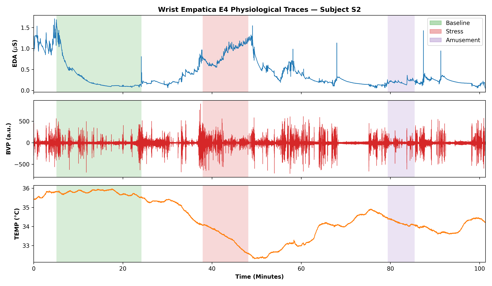
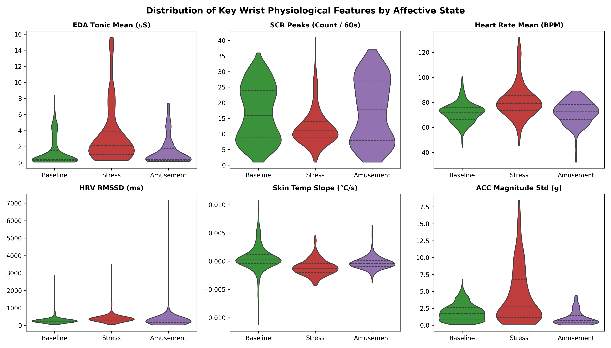
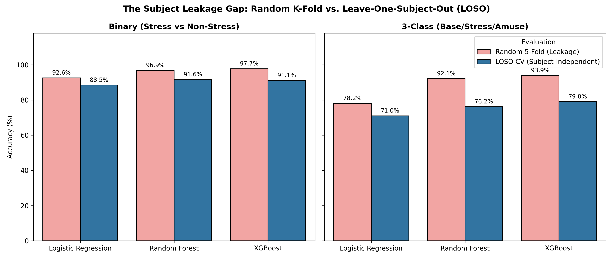
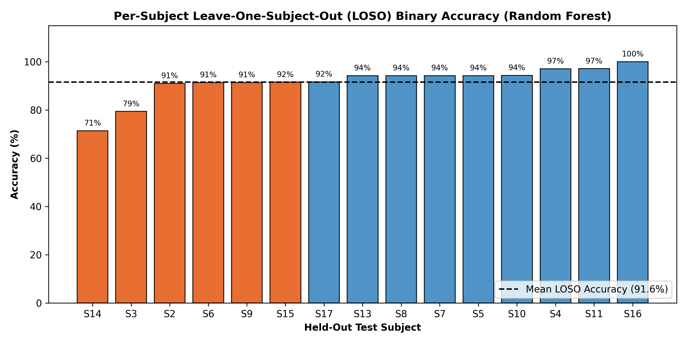
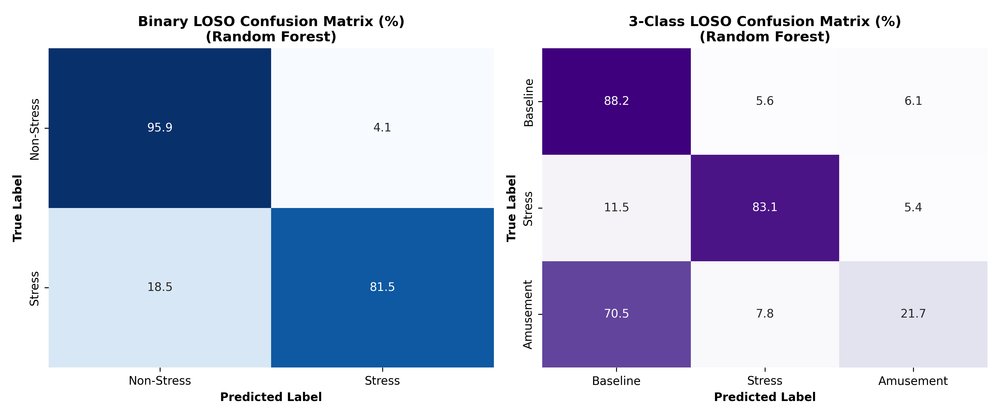
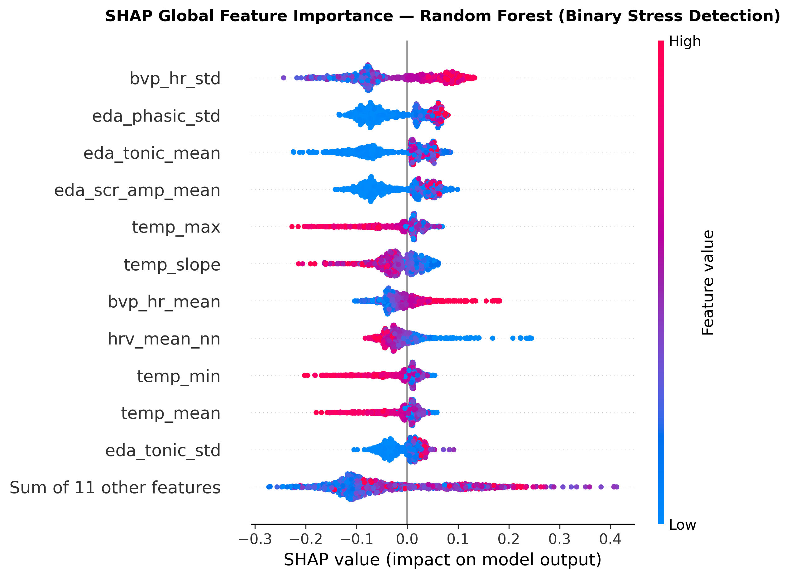
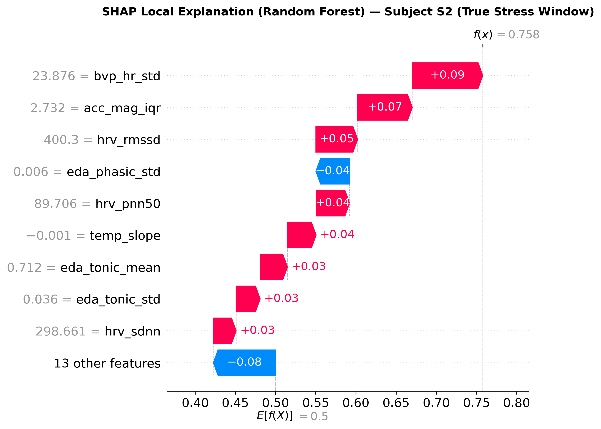
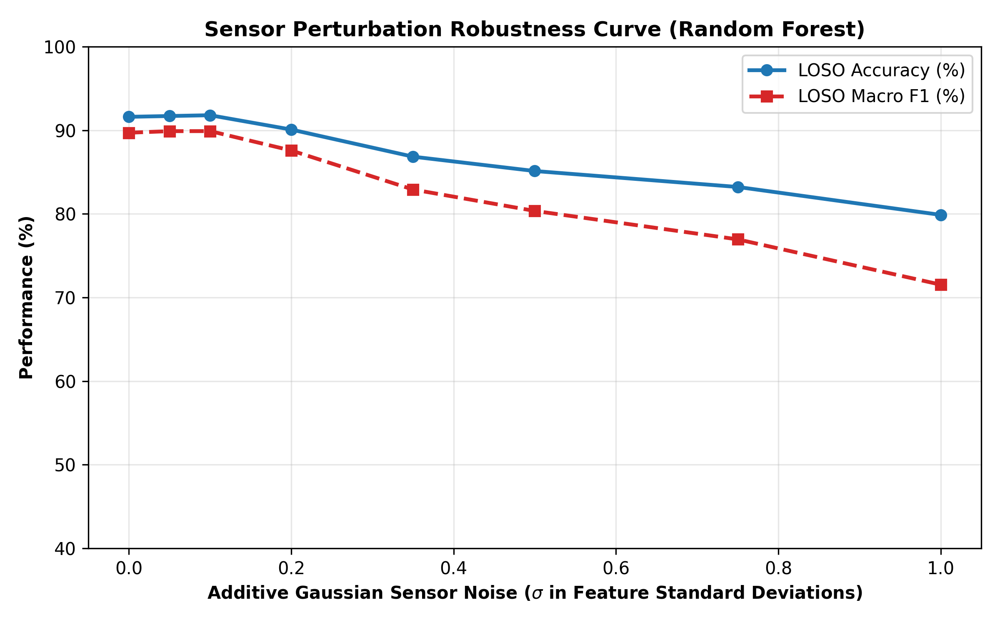

# Explainable Stress Detection from Wearable Physiological Signals (WESAD)

An end-to-end, CPU-efficient physiological signal processing and explainable machine learning pipeline that detects acute human stress exclusively from wrist-worn wearable sensors (**Empatica E4**)[cite: 23, 24]. Built on the [UCI WESAD (Wearable Stress and Affect Detection) Dataset](https://archive.ics.uci.edu/dataset/465/wesad+wearable+stress+and+affect+detection), this project emphasizes **subject-independent generalization via Leave-One-Subject-Out (LOSO) cross-validation**, **data-leakage quantification**, **SHAP model explainability**, and **sensor perturbation robustness**—serving as a foundational physiological modeling bridge toward **real-time cybersickness prediction in Virtual Reality (VR)**[cite: 23, 24].

---

## 1. Project Motivation & Pipeline Architecture

Wearable affect and stress detection studies frequently suffer from two major pitfalls: relying on intrusive chest-strap ECG hardware that is impractical for everyday consumer or VR settings, and evaluating models via random $k$-fold cross-validation where overlapping sliding windows from the same subject leak across training and test splits.

This repository addresses both challenges through a four-stage architecture:
1. **Wrist-Only Multi-Modal Signal Processing**: Synchronizes 700 Hz ground-truth protocol labels (`1`: Baseline, `2`: Stress, `3`: Amusement) with Empatica E4 wrist streams: **EDA (4 Hz)**, **BVP (64 Hz)**, **TEMP (4 Hz)**, and **3-Axis ACC (32 Hz)**[cite: 23, 24]. Applies zero-phase Butterworth filtering and segments streams into 60-second windows with a 30-second step ($\ge 80\%$ label purity), extracting **22 physiological and kinematic features** across **1,049 windows** (15 subjects: `S2`–`S17`, excluding `S12`) and caching the tidy table to Parquet (`outputs/wesad_wrist_features.parquet`)[cite: 14, 23, 24].
2. **Subject-Independent Modeling & Leakage Quantification**: Evaluates **Logistic Regression**, **Random Forest**, and **XGBoost** pipelines on both **Binary** (Stress vs. Non-Stress) and **3-Class** (Baseline vs. Stress vs. Amusement) tasks under strict **Leave-One-Subject-Out (LOSO)** cross-validation, directly contrasting performance against a 5-fold Stratified Random Split[cite: 23, 24].
3. **Global & Local Explainability (SHAP)**: Decomposes predictions using `shap.TreeExplainer` (`beeswarm` global attributions and single-window `waterfall` local breakdowns) to verify that tree ensembles rely on genuine sympathetic and parasympathetic biomarkers rather than spurious confounders[cite: 20, 21, 23, 24].
4. **Sensor Perturbation Robustness**: Audits classifier degradation under escalating additive Gaussian sensor noise ($\sigma \in [0.0, 1.0]$ scaled by training feature standard deviations)[cite: 22, 23, 24].

---

## 2. Extracted Wrist Physiological Features (22 Features)

| Modality | Sampling Rate | Signal Filtering | Extracted Features (60 s Window, 30 s Step) | Count |
| :--- | :--- | :--- | :--- | :--- |
| **EDA** (Electrodermal Activity) | 4 Hz | 2nd-order Butterworth low-pass (1.0 Hz) + `neurokit2` tonic/phasic decomposition | `eda_tonic_mean`, `eda_tonic_std`, `eda_phasic_mean`, `eda_phasic_std`, `eda_scr_count`, `eda_scr_amp_mean`, `eda_slope` | 7 |
| **BVP** (Blood Volume Pulse / PPG) | 64 Hz | 3rd-order Butterworth band-pass (0.5–8.0 Hz) + `neurokit2` PPG peak & HRV time-domain analysis | `bvp_hr_mean`, `bvp_hr_std`, `hrv_rmssd`, `hrv_sdnn`, `hrv_pnn50`, `hrv_mean_nn` | 6 |
| **TEMP** (Peripheral Skin Temperature) | 4 Hz | 2nd-order Butterworth low-pass (0.5 Hz) + linear temporal regression | `temp_mean`, `temp_std`, `temp_min`, `temp_max`, `temp_slope` | 5 |
| **ACC** (3-Axis Accelerometer) | 32 Hz | 3D Euclidean magnitude $\lVert \mathbf{a} \rVert_2$ & first-order temporal jerk | `acc_mag_mean`, `acc_mag_std`, `acc_mag_iqr`, `acc_jerk_mean` | 4 |

---

## 3. Experimental Results & Portfolio Visualizations

### 3.1 Raw Physiological Traces & Protocol Condition Bands
Filtered wrist `EDA`, `BVP`, and `TEMP` signals across the experimental timeline for Subject `S2`[cite: 15, 23]. Shaded intervals highlight distinct autonomic shifts during the Trier Social Stress Test (**Stress**, red) compared to **Baseline** (green) and **Amusement** (purple), including a pronounced surge in tonic/phasic skin conductance and peripheral vasoconstriction (temperature drop)[cite: 15, 23].



---

### 3.2 Physiological Feature Distributions by Affective State
Violin distributions across all 1,049 windows illustrate clear separation during **Stress**: elevated tonic EDA (`eda_tonic_mean`), increased heart rate (`bvp_hr_mean`), negative skin temperature slope (`temp_slope`) driven by sympathetic vasoconstriction, and heightened wrist movement variability (`acc_mag_std`)[cite: 14, 16, 23].



---

### 3.3 Quantitative Model Comparison: LOSO vs. Random Split Leakage Gap

| Classification Task | Model | Random 5-Fold Accuracy (Leakage) | LOSO CV Accuracy (Subject-Independent) | Leakage Inflation Gap |
| :--- | :--- | :---: | :---: | :---: |
| **Binary** *(Stress vs. Non-Stress)* | **Logistic Regression** | 92.6% | 88.5% | +4.1% |
| **Binary** *(Stress vs. Non-Stress)* | **Random Forest** *(Best Binary)* | 96.9% | **91.6%** | +5.3% |
| **Binary** *(Stress vs. Non-Stress)* | **XGBoost** | 97.7% | 91.1% | +6.6% |
| **3-Class** *(Baseline / Stress / Amusement)* | **Logistic Regression** | 78.2% | 71.0% | +7.2% |
| **3-Class** *(Baseline / Stress / Amusement)* | **Random Forest** | 92.1% | 76.2% | +15.9% |
| **3-Class** *(Baseline / Stress / Amusement)* | **XGBoost** *(Best 3-Class)* | 93.9% | **79.0%** | +14.9% |

Evaluating models via random 5-fold cross-validation artificially inflates accuracy by **+4.1% to +6.6%** on the Binary task and up to **+15.9%** on the 3-Class task because adjacent 50%-overlapping windows from the same subject appear in both training and test folds, allowing tree ensembles to memorize subject-specific autonomic baselines[cite: 18, 23].



---

### 3.4 Per-Subject Generalization & Failure Analysis
Under strict Binary LOSO evaluation (`Random Forest`, **91.6%** mean accuracy), 13 of 15 held-out subjects achieve $\ge 91\%$ accuracy (peaking at **100%** on `S16` and **97%** on `S4` and `S11`), while performance dips on `S14` (**71%**) and `S3` (**79%**), reflecting inter-individual differences in baseline sudomotor reactivity and wrist sensor contact[cite: 17].



---

### 3.5 Subject-Independent Confusion Matrices
In the Binary LOSO task, `Random Forest` correctly identifies **95.9%** of Non-Stress windows and **81.5%** of Stress windows[cite: 19]. In the 3-Class LOSO task, `Baseline` (**88.2%**) and `Stress` (**83.1%**) are well separated, whereas `Amusement` (**21.7%** recall) is frequently confused with `Baseline` (**70.5%**) due to similar low-arousal wrist physiological profiles during passive video viewing[cite: 19].



---

### 3.6 Explainable AI: Global & Local SHAP Attributions
SHAP analysis on the winning Binary model (`Random Forest`) confirms physiologically grounded decision-making[cite: 20, 21]:
* **Global Importance (`06a_shap_beeswarm.png`)**: Heart rate variability/dispersion (`bvp_hr_std`), phasic skin conductance bursts (`eda_phasic_std`), tonic skin conductance level (`eda_tonic_mean`), SCR peak amplitude (`eda_scr_amp_mean`), and peripheral skin temperature (`temp_max`, `temp_slope`) dominate model predictions[cite: 20].
* **Local Single-Window Breakdown (`06b_shap_waterfall.png`)**: For a true Stress window from Subject `S2`, elevated heart rate variability (`bvp_hr_std = 23.876`, $+0.09$), wrist motion (`acc_mag_iqr = 2.732`, $+0.07$), negative temperature slope (`temp_slope = -0.001`, $+0.04$), and tonic EDA (`eda_tonic_mean = 0.712`, $+0.03$) push the predicted stress probability from the base rate $E[f(X)] = 0.50$ to $f(x) = 0.758$[cite: 21].

| Global SHAP Summary (Beeswarm) | Local Single-Window Explanation (Waterfall) |
| :---: | :---: |
|  |  |

---

### 3.7 Sensor Perturbation Robustness
To simulate motion artifacts and electrode impedance drift in wearable deployments, zero-mean Gaussian noise $\mathcal{N}(0, (\sigma \cdot \text{SD}_{\text{train}})^2)$ was injected into test-fold features across $\sigma \in [0.0, 1.0]$[cite: 22, 23]. Binary LOSO accuracy remains highly resilient up to $\sigma = 0.20$ (**90.1%** accuracy, **87.6%** Macro F1) and degrades gracefully to **79.9%** accuracy (**71.6%** Macro F1) at $\sigma = 1.0$[cite: 22].



---

## 4. Connection to VR Cybersickness Prediction & Adversarial Robustness

This wearable stress detection pipeline directly informs ongoing research into **Virtual Reality (VR) cybersickness forecasting** and **Universal Adversarial Perturbations (UAPs)** on physiological time series[cite: 23, 24]:

1. **Shared Autonomic Nervous System (ANS) Pathways**: Visually induced motion sickness (cybersickness) in Head-Mounted Displays (HMDs) triggers acute sympathetic arousal and vagal withdrawal prior to subjective nausea—manifesting as sudomotor skin conductance bursts (`eda_phasic_std`, `eda_tonic_mean`), peripheral vasoconstriction (`temp_slope < 0`), and heart rate fluctuations (`bvp_hr_std`, `hrv_rmssd`)[cite: 20, 21, 23]. The exact wrist feature engineering and SHAP verification framework built here transfers directly to early cybersickness onset detection[cite: 23].
2. **Cold-Start Generalization to Unseen VR Users**: Commercial VR systems cannot require new users to undergo sickness-inducing calibration sessions before gameplay[cite: 23]. Enforcing **Leave-One-Subject-Out (LOSO)** validation mirrors the cold-start deployment regime required for real-time adaptive comfort interventions (e.g., dynamic field-of-view vignetting or locomotion damping)[cite: 23].
3. **Motion Artifacts & Perturbation Robustness**: Active 6-DoF VR controller interaction introduces substantial physical movement artifacts into optical PPG (`BVP`) and dry-electrode `EDA` signals[cite: 23]. Explicitly modeling kinematic features (`acc_mag_std`, `acc_mag_iqr`, `acc_jerk_mean`) alongside our Gaussian noise stress-test (`07_noise_robustness_curve.png`) establishes a quantitative baseline for evaluating classifier vulnerability and defense mechanisms against **Universal Adversarial Perturbations (UAPs)** in multimodal physiological computing[cite: 14, 21, 22, 23, 24].

---

## 5. Repository Structure

```text
├── explainable_stress_detection_wesad.ipynb   # Self-contained step-by-step Jupyter Notebook
├── wesad_pipeline.py                          # Standalone end-to-end Python execution script
├── README.md                                  # Project documentation and portfolio report
└── outputs/
    ├── wesad_wrist_features.parquet           # Cached feature table (1,049 windows × 27 columns)
    └── figures/                               # 300 DPI portfolio visualizations
        ├── 01_raw_signals_condition_bands.png
        ├── 02_feature_violin_plots.png
        ├── 03_loso_per_subject_accuracy.png
        ├── 04_loso_vs_random_leakage_gap.png
        ├── 05_confusion_matrices.png
        ├── 06a_shap_beeswarm.png
        ├── 06b_shap_waterfall.png
        └── 07_noise_robustness_curve.png